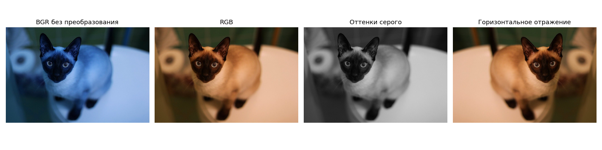
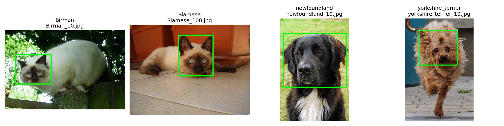

# Лабораторная 1. Среда, репозиторий и первый взгляд на данные

**Вариант:** 22

## 1. Задача

Исследовать изображения и разметку своего варианта Oxford-IIIT Pet, выполнить базовые преобразования изображений и подготовить воспроизводимый ноутбук со статистикой и примерами.

## 2. Как запустить

Работа выполнена в Google Colab. Открыть `solution.ipynb`, установить `VARIANT = 22` в первой ячейке и оставить `DATA_SOURCE = None`. Перезапустить сеанс и выполнить все ячейки сверху вниз через Run all. Для загрузки данных требуется интернет.

Первая ячейка автоматически скачивает данные варианта. Результаты записываются в папку `results/`; последняя ячейка упаковывает их в архив для скачивания.

## 3. Данные

Использован вариант 22 версии `v1` датасета [Oxford-IIIT Pet](https://www.robots.ox.ac.uk/~vgg/data/pets/): 800 изображений четырёх пород. Кошки — `Birman` и `Siamese`, собаки — `newfoundland` и `yorkshire_terrier`. Каждая порода представлена 200 изображениями.

Данные получены через загрузчик из [репозитория курса](https://github.com/ykvnkm/computer-vision-course/blob/main/data/README.md). Исходные изображения и разметка в репозиторий решения не включены. По метаданным варианта лицензия датасета — CC BY-SA 4.0; источник: O. M. Parkhi, A. Vedaldi, A. Zisserman, C. V. Jawahar, *Cats and Dogs*, CVPR 2012.

## 4. Результаты

Полная числовая сводка: [summary.csv](results/summary.csv).

| Показатель | Значение |
|---|---:|
| Изображений | 800 |
| Пород | 4 |
| Изображений кошек / собак | 400 / 400 |
| Изображений каждой породы | 200 |
| Ширина: минимум / медиана / максимум, пикселей | 133 / 500 / 679 |
| Высота: минимум / медиана / максимум, пикселей | 150 / 375 / 798 |
| Файлов с режимом не RGB | 0 |
| Файлов `.jpg`, фактически имеющих формат не JPEG | 0 |
| Изображений с XML-разметкой головы | 400 |
| Доля изображений с XML-разметкой головы | 50% |

Проблемных файлов по двум проверкам не обнаружено. Поэтому обычное чтение OpenCV и `IMREAD_UNCHANGED` сравнены на обычном RGB JPEG `Siamese_208.jpg`: в обоих случаях получена форма `(333, 500, 3)`.

Базовые преобразования: изображение BGR при отображении без преобразования, корректное RGB, оттенки серого и горизонтальное отражение. Ресайз до 224×224 выполнен отдельно в ноутбуке.

По одному изображению каждой породы с рамками головы из XML:

## 5. Выводы

- Распределение по породам равномерное: все 4 породы содержат по 200 изображений. По видам также соблюдён баланс — 400 кошек и 400 собак.
- XML-разметка головы имеется для 400 из 800 изображений, то есть для 50% набора. При использовании этой разметки для детекции нужно выбирать фотографии с соответствующим XML.
- Размеры кадров различаются: ширина составляет 133–679 пикселей, высота — 150–798. Прямой ресайз прямоугольного кадра до 224×224 меняет его пропорции; это следует учитывать при подготовке изображений для модели.
- Проверка Pillow не выявила файлов с режимом не RGB (0) и файлов `.jpg` с фактическим форматом не JPEG (0). В этом варианте по результатам этих проверок исправление режима или формата не потребовалось.
