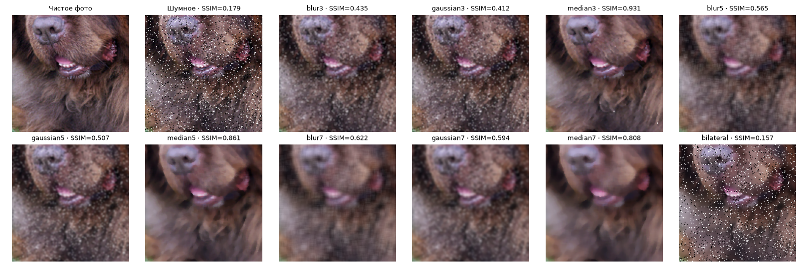
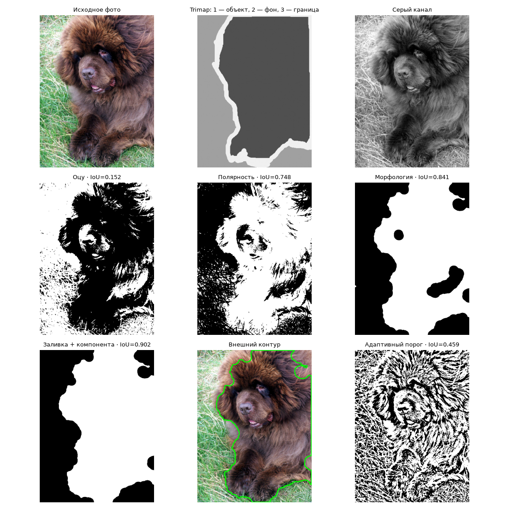
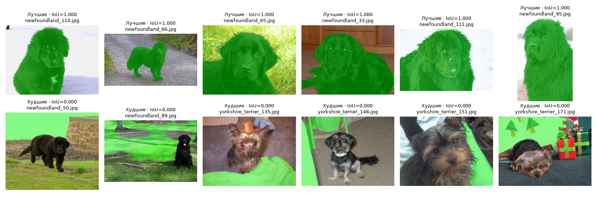

# Лабораторная 2. Классическая обработка изображений

**Шереметов Мурат Олегович · Т.МО41 · вариант 22**

## 1. Задача

Исследовать яркость, контраст, шум и резкость фотографий животных, сравнить коррекцию освещённости
и фильтры. Построить сегментацию без нейросети, оценить её по trimap и вычислить признаки формы масок.

## 2. Как запустить

Открыть [solution.ipynb](solution.ipynb) в Google Colab, выбрать CPU и выполнить
«Среда выполнения → Перезапустить сеанс и выполнить всё». В первой ячейке уже указаны
`VARIANT = 22` и `DATA_SOURCE = None`. Интернет нужен для загрузки данных и отсутствующих библиотек.
Ноутбук автоматически скачивает загрузчик курса и данные в `/content/data`, создаёт `results/`
и в конце скачивает `results.zip`. Его содержимое нужно распаковать в `lab02/results/`.
Сам ноутбук сохраняется через «Файл → Скачать → Скачать файл IPYNB» под именем `solution.ipynb`.

Сохранённые выводы получены полным локальным запуском на CPU: Python 3.12.10,
OpenCV 4.14.0, NumPy 2.5.4, pandas 2.3.3, scikit-image 0.26.0.
Локально ноутбук запускается из папки `lab02/`, данные размещаются в соседней `data/`.
В Kaggle нужно включить Internet; GPU не требуется. Время фильтрации зависит от процессора.

## 3. Данные

Вариант **22**, версия **v1**, источник — релиз курса.
800 фото: `Birman`, `Siamese`, `newfoundland`, `yorkshire_terrier`, по 200 каждой породы;
400 кошек и 400 собак. Для сегментации используются все 800 trimap.
Длинная сторона фото приводится к 512 px с сохранением пропорций;
маски масштабируются ближайшим соседом. В trimap 1 — животное, 2 — фон, 3 — граница;
пиксели границы исключаются из IoU.

Шум из `NOISE_PLAN[22]`: **«соль и перец», amount = 0.10**.
Для сравнения фильтров выбраны 30 фото через `labels.sample(30, random_state=22)`;
seed шума для i-го фото равен `2200 + i`. В части 2 используются исходные фото без искусственного шума.

Источник задания и загрузчика: [computer-vision-course, lab02](https://github.com/ykvnkm/computer-vision-course/tree/main/labs/lab02).
Исходный датасет: [Oxford-IIIT Pet](https://www.robots.ox.ac.uk/~vgg/data/pets/),
O. M. Parkhi, A. Vedaldi, A. Zisserman, C. V. Jawahar, *Cats and Dogs*, CVPR 2012.
По метаданным варианта лицензия — CC BY-SA 4.0. Полные данные и служебные файлы в решение не включены.

## 4. Результаты

Все 9 обязательных файлов созданы. В [part1_stats.csv](results/part1_stats.csv)
и [masks.csv](results/masks.csv) по 800 строк.
Дополнительные [illumination.csv](results/illumination.csv) и [channels.csv](results/channels.csv)
содержат числа для проверки выводов.

**Фильтрация:** `BEST_FILTER = "median3"`. Метрики усреднены по 30 фото,
время измерено только для вызова фильтра, без чтения файлов и расчёта PSNR/SSIM.
Режим «без фильтра» измеряет возврат исходного массива.

| Режим | PSNR, дБ | SSIM | мс/кадр |
|---|---:|---:|---:|
| Шумное фото, без фильтра | 14.86 | 0.1792 | 0.001 |
| median3 | 33.91 | 0.9306 | 0.308 |
| median5 | 31.26 | 0.8606 | 1.511 |

Полное сравнение 10 фильтров и режима без обработки: [filters.csv](results/filters.csv).
Кропы 160×160; в подписях средняя SSIM по 30 полным фотографиям.

Статистика яркости: [histograms.png](results/histograms.png).
Сравнение коррекции пяти самых тёмных кадров: [illumination.png](results/illumination.png).
Свёртка `filter2D` с ядром 3×3 из 1/9 совпала с `blur(3×3)`: максимальная разница **0**.

**Сегментация:** `CHANNEL = "L"`, фильтр `median3`,
эллиптические ядра открытия 7×7 и закрытия 31×31, заливка дыр и самая большая компонента.
Выбор канала сделан по средней IoU среди шести каналов на том же наборе из 800 фото.

| Этап | Средняя IoU | Медианная IoU |
|---|---:|---:|
| 1 только Оцу | 0.2314 | 0.1975 |
| 2 + фильтр из части 1 | 0.2315 | 0.1992 |
| 3 + полярность | 0.4204 | 0.3821 |
| 4 + морфология | 0.4422 | 0.4041 |
| 5 + заливка и компонента | 0.4657 | 0.4244 |

Источник: [ablation.csv](results/ablation.csv).
Следующая иллюстрация показывает учебный проход по одному кадру в сером канале без фильтра;
он отличается от итоговой конфигурации L + median3.

Средние признаки по породам, рассчитанные по итоговым предсказанным маскам:

| Порода | IoU | Доля площади | Вытянутость | Округлость | Solidity |
|---|---:|---:|---:|---:|---:|
| Birman | 0.4230 | 0.3878 | 1.508 | 0.317 | 0.720 |
| Siamese | 0.3949 | 0.3817 | 1.444 | 0.291 | 0.695 |
| newfoundland | 0.6659 | 0.4541 | 1.472 | 0.373 | 0.764 |
| yorkshire_terrier | 0.3789 | 0.4384 | 1.449 | 0.264 | 0.705 |

Полная таблица дополнительно содержит периметр и ограничивающий прямоугольник `x, y, w, h`
в масштабе обработки. Пустых масок: **0**.
Для пустого/вырожденного контура неопределённые отношения записываются как NaN.

Лучшие 6 масок находятся в верхнем ряду, худшие 6 — в нижнем; зелёный цвет обозначает предсказание.
IoU в подписях округлена до трёх знаков. Даже IoU = 1 на учитываемых пикселях не означает
точного совпадения границ: зона trimap = 3 исключена из оценки.

## 5. Выводы

1. **Фильтрация.** `median3` дал PSNR **33.91 дБ** и SSIM **0.9306**, а шумное фото без фильтра — 14.86 дБ и 0.1792. Победители по PSNR и SSIM совпали; отрыв от `median5` составляет 2.65 дБ и 0.0700 SSIM. Медиана устраняет одиночные выбросы «соли и перца», а небольшое окно сохраняет фактуру шерсти лучше крупных окон. Источник: [filters.csv](results/filters.csv).

2. **Освещённость и цвет.** На пяти самых тёмных фото независимое выравнивание RGB дало средний сдвиг цвета **21.81**, выравнивание L — 1.09, CLAHE по L — **0.29**. CLAHE повысил среднее L с 49.48 до 69.96. Изменение каждого канала RGB по своей функции нарушает отношения между каналами, что заметно по неестественным оттенкам; обработка только L сохраняет их значительно лучше. Источник: [illumination.csv](results/illumination.csv), средние по пяти фото.

3. **Выбор канала.** Лучшим оказался **L: средняя IoU 0.4657**. У V она равна 0.4587, у серого — 0.4523, у a — 0.3104. В этом наборе разделение по светлоте в среднем оказалось полезнее разделения по цветовому каналу a; разница L и V невелика. Канал выбран на тех же 800 фото, поэтому это результат на учебном наборе, а не оценка обобщения на новых данных. Источник: [channels.csv](results/channels.csv).

4. **Вклад этапов.** Основной прирост дала проверка полярности: средняя IoU выросла с 0.2315 до **0.4204** (на 0.1889). Один фильтр изменил IoU лишь на 0.000116, а весь алгоритм — с 0.2314 до 0.4657. Оцу выбирает порог, но сам не определяет, какой класс является животным; инверсия часто исправляет выбор светлого фона вместо тёмной шерсти. В этой части искусственный шум не добавлялся, поэтому эффект фильтра невелик. Источник: [ablation.csv](results/ablation.csv).

5. **Ошибки сегментации.** У **14 изображений IoU равна 0**; в шести худших примерах на рисунке зелёная маска попадает на фон. Например, `newfoundland_50.jpg` и `newfoundland_89.jpg` имеют IoU 0: алгоритм выбирает светлую область вокруг тёмной собаки. Предположение о фоне по краям и выбор самой большой компоненты не гарантируют, что будет выделено именно животное. Источник: [masks.csv](results/masks.csv) и [best_worst.png](results/best_worst.png).

6. **Форма предсказанных масок.** Средняя вытянутость у кошек составляет **1.476**, у собак — **1.460**; средняя solidity — 0.707 и 0.734. Разница по вытянутости мала. Эти признаки нельзя напрямую считать свойствами пород: при ошибке сегментации они описывают кусок фона, а закрытие и заливка меняют форму маски. Источник: [masks.csv](results/masks.csv), группировка по species.
